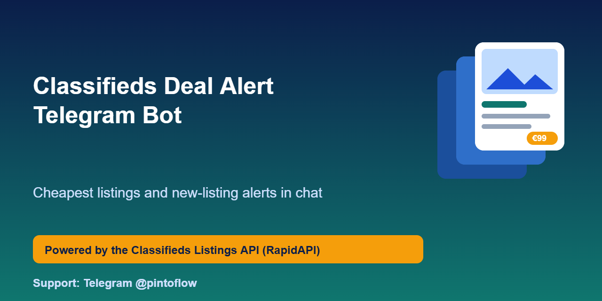
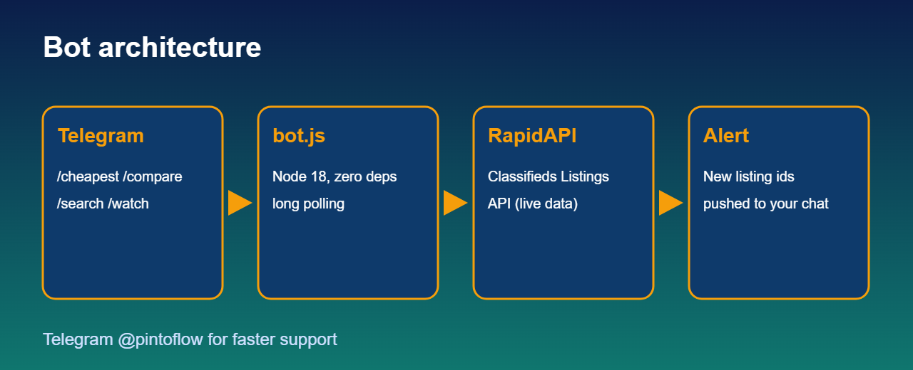

<p align="center"></p>

# Classifieds Deal Alert Telegram Bot

Ask Telegram for the cheapest used items across five marketplaces and get pinged the moment a new listing appears. **Zero dependencies**, Node 18+, one file. Built on the [Classifieds Listings API](https://rapidapi.com/belchiorarkad-FqvHs2EDOtP/api/classifieds-listings-api).

> ⚡ Support and feature requests: Telegram **[@pintoflow](https://t.me/pintoflow)**



## Commands

| Command | Example | What you get |
|---|---|---|
| `/cheapest <query> [max=N] [sources=a,b]` | `/cheapest iphone 13 max=400` | Cheapest listings right now, with links |
| `/compare <query>` | `/compare iphone 13` | Min / avg / max price per source |
| `/search <query>` | `/search sofa sources=olx` | Plain merged search |
| `/watch <query> [max=N]` | `/watch ps5 max=300` | Alert for every NEW listing |
| `/stop` | `/stop` | Stop alerts |

## Setup

1. Create a bot with [@BotFather](https://t.me/BotFather) and copy the token.
2. Subscribe to the API (free plan available).
3. Run:

```bash
git clone https://github.com/BelNaruto/classifieds-deal-alert-telegram-bot
cd classifieds-deal-alert-telegram-bot
export TELEGRAM_TOKEN=... RAPIDAPI_KEY=... RAPIDAPI_HOST=classifieds-listings-api.p.rapidapi.com
node bot.js
```

Host it anywhere that runs Node: a $5 VPS, Fly.io, Railway or a Cloud Run job.

## How alerts work

`/watch` remembers the listing ids it has already seen. Every `POLL_SECONDS` (default 180) it calls `/api/search/cheapest` and messages you only about listings it has not sent before. Each watcher costs about 480 calls/day at the default interval, so raise `POLL_SECONDS` or use a higher plan for many watchers. The API also has native **price alerts with webhooks** (`POST /api/alerts`) if you prefer server-side checks.

## Ideas to extend

- Persist watchers in a file or Redis so they survive restarts
- Per-user budgets and category filters
- Photos in the alert message using the first image of each listing

## Get an API key

Subscribe to the API (free plan available): https://rapidapi.com/belchiorarkad-FqvHs2EDOtP/api/classifieds-listings-api

## Disclaimer

Unofficial; not affiliated with Meta, OLX, Wallapop, Leboncoin or Custojusto. Prices and availability come from the marketplaces and can change at any time.

---
> 💬 Telegram **[@pintoflow](https://t.me/pintoflow)**
